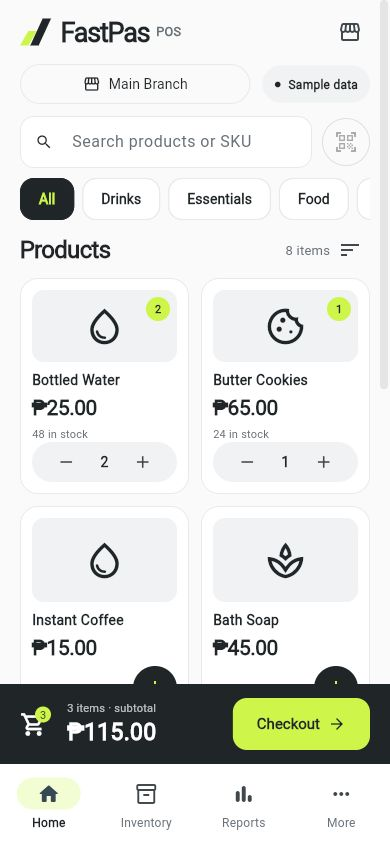

# FastPas POS

FastPas POS, formerly VaseNizz, is a Flutter-based mobile point-of-sale app evolving into a general retail system for sales, inventory, staff, multi-branch management, and reporting, with planned AI integration for sales insights and inventory assistance.

The name combines **fast** and **paspas**, a Cebuano word associated with speed.

## Project status

**Work in progress.** The Graphite Volt redesign includes sign-in, product-first Home, order review, payment, and receipt screens. Inventory, Reports, and More have new navigation hubs; deeper management screens still need updates. The backend migration and AI features remain planned. The application is not ready for live store use.

Existing functionality includes:

- Product browsing, cart, discounts, checkout, and receipts.
- Branch inventory, suppliers, and stock movement history.
- Employee management and GPS attendance.
- Sales dashboards and PDF/CSV reporting.

These workflows still require full end-to-end validation.

## Interface

**Graphite Volt** uses charcoal (`#202528`), electric lime (`#CEF54A`), and off-white (`#FAFAFA`). Home opens directly to products, with search, category filters, quantity controls, and a persistent checkout bar.

*Flutter UI preview with sample data. No store transactions are saved. Products currently use category icons; barcode scanning is disabled and planned.*

More screenshots: [tablet](docs/screenshots/home-tablet.png), [order review](docs/screenshots/order-review-phone.png), [payment](docs/screenshots/payment-phone.png), and [receipt](docs/screenshots/receipt-phone.png).

## Roadmap

1. Interface redesign.
2. Technical baseline and database audit.
3. Database and authentication foundation.
4. Business settings and configurable branches.
5. General catalog and reliable inventory operations.
6. Atomic checkout and saved receipts.
7. Returns, refunds, and cashier shifts.
8. Reports and optional modules.
9. Device pilot and release.

See the [product roadmap](docs/ROADMAP.md) for scope and current progress.

AI sales summaries and inventory insights are planned after the core retail workflows are reliable. No provider has been selected and no AI feature is implemented yet.

## Stack and scope

- Flutter / Dart.
- Supabase client integration.
- Android is the first intended release target; other platform folders do not establish platform support.
- One business per deployment, with multiple branches planned.

The internal Dart package remains `vasenizzpos` while the application is being adapted to FastPas.
