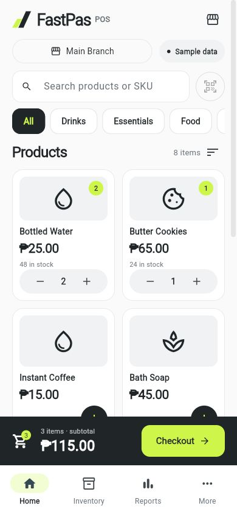

# FastPas POS

FastPas POS, formerly VaseNizz, is a Flutter-based mobile point-of-sale app evolving into a general retail system for sales, inventory, staff, multi-branch management, and reporting, with planned AI integration for sales insights and inventory assistance.

The name combines **fast** and **paspas**, a Cebuano word associated with speed.

## Project status

**Phase 10: release validation.** The default app supports Supabase Auth, owner-created businesses, branch-scoped staff permissions, catalog and inventory management, offline cash selling, saved receipts, cash returns, cashier shifts and branch cash reports. All eleven repository migrations were verified on the development project on 13 November 2026. Hosted account/API checks and Android emulator checks have passed for their documented scopes. Physical two-phone acceptance, real email callbacks, production setup and store publication remain open. See [release preparation](docs/RELEASE.md) and the [roadmap](docs/ROADMAP.md). The application is not ready for live store use.

The legacy interface includes:

- Product browsing, cart, discounts, checkout, and receipts.
- Branch inventory, suppliers, and stock movement history.
- Employee management and GPS attendance.
- Sales dashboards and PDF/CSV reporting.

These workflows still require full end-to-end validation.

## Interface

**Graphite Volt** uses charcoal (`#202528`), electric lime (`#CEF54A`), and a light gray background (`#EDF0F2`). Home opens directly to products, with search, category filters, quantity controls, and a persistent checkout bar.



*Flutter UI preview with sample data. No store transactions are saved. Products currently use category icons; barcode scanning is disabled and planned.*

More screenshots: [tablet](docs/screenshots/home-tablet.jpg), [order review](docs/screenshots/order-review-phone.jpg), [payment](docs/screenshots/payment-phone.jpg), and [receipt](docs/screenshots/receipt-phone.jpg).

Management previews: [staff](docs/screenshots/staff-phone.jpg), [suppliers](docs/screenshots/suppliers-phone.jpg), and [reports](docs/screenshots/reports-tablet.jpg).

## Local UI preview

```sh
flutter pub get
flutter run -d chrome -t lib/preview/main.dart
```

This entry point uses local sample data. Management requests use a read-only transport with no network fallback; no store changes or payments are saved. The normal app still requires the store configuration described in `config/supabase.example.json`.

## Refactor

Branch management and branch inventory use shared screens driven by saved branch identities. Session navigation, sign-in, calendar actions, stock adjustments, sale persistence, receipt reads, pricing, and report calculations now have shared modules. Unused parallel selling screens were removed.

See [architecture](docs/ARCHITECTURE.md), [database contracts](docs/DATABASE.md), and [business workspaces](docs/BUSINESSES.md).

## Backend setup

Follow [fresh Supabase setup](docs/SETUP.md) to create a development project, apply the eleven migrations in order, enable email confirmation, configure `fastpas://auth-callback`, and fill the ignored `config/supabase.local.json` file. Existing projects apply only missing migrations after the documented checks. No legacy export is needed for a new database.

```sh
flutter run --dart-define-from-file=config/supabase.local.json
```

The default app supports registration, verification resend, password recovery, owner-created businesses, staff invitations and access controls, and accessible branches. Branches open [hybrid cash selling](docs/HYBRID.md): downloaded catalog, local receipts and stock deductions, pending uploads, and automatic retry while open. SQLite persistence targets Android/iOS/macOS; this flow is not a web preview.

The explicit `lib/workspaces/main.dart` target launches the same app. `lib/legacy_main.dart` retains the historical single-store flow for migration development and requires its old schema. Workspace navigation does not open those legacy routes. Attendance, suppliers, calendar and file workflows still need their business-scoped adaptation.

## Validation

On 16 November 2026, all 206 ordinary Flutter tests passed with the opt-in hosted-write test skipped, and static analysis was clean. On 14 November, the configured profile APK and a bundle signed with a temporary acceptance key built and passed signature verification. The production application ID, owner-controlled upload key and publication remain separate steps.

The [hosted acceptance runs](docs/HOSTED_ACCEPTANCE.md) cover real Auth/API isolation, catalog operations, two desktop SQLite registers, concurrent returns and drawer/report reconciliation. An application-data restore rehearsal passed 100 checks. These results do not verify managed Auth recovery, email delivery or physical hardware.

The [Android emulator checks](docs/DEVICE_ACCEPTANCE.md) verified a real offline cash sale, force-stop/reopen, development-backend reconnect without duplicates, original-price refund, drawer totals and CSV saving. On 16 November 2026, three additional native SQLite recovery scenarios passed for older database upgrades and a simulated lost upload reply. The HTTP boundary in that repeatable suite is simulated; the earlier manual emulator run used the actual development backend. Android callbacks, physical-device acceptance and external CSV viewer handoff remain open; iOS has not been built on macOS.

Run `flutter analyze --no-pub` and `flutter test --no-pub --concurrency=1` for local checks. Backend runner setup and commands are in [hosted acceptance](docs/HOSTED_ACCEPTANCE.md); native test commands are in [device acceptance](docs/DEVICE_ACCEPTANCE.md#repeatable-android-database-recovery-tests).

The Android build uses Gradle 8.14.3, Android Gradle Plugin 8.11.1, Kotlin 2.2.21 and Java 17 bytecode. The development baseline is Flutter 3.47.4 / Dart 3.13. Existing toolchain deprecation warnings are recorded in [release preparation](docs/RELEASE.md).

## Roadmap

1. Interface redesign.
2. Technical baseline, codebase refactor, and database audit.
3. Database and authentication foundation.
4. Business settings and configurable branches.
5. General catalog and reliable inventory operations.
6. Atomic checkout and saved receipts.
7. Returns, refunds, and cashier shifts.
8. Reports and optional modules.
9. Offline synchronization.
10. Device pilot and release.

See the [product roadmap](docs/ROADMAP.md) for scope and current progress.

AI sales summaries and inventory insights are planned after the core retail workflows are reliable. No provider has been selected and no AI feature is implemented yet.

## Stack and scope

- Flutter / Dart.
- Supabase client integration.
- Android is the first intended release target; other platform folders do not establish platform support.
- Multi-business workspaces have development-backend isolation checks; broader feature adaptation and production acceptance remain. Optional old-record imports require a separate tenant migration.

The internal Dart package remains `vasenizzpos` while the application is being adapted to FastPas.
